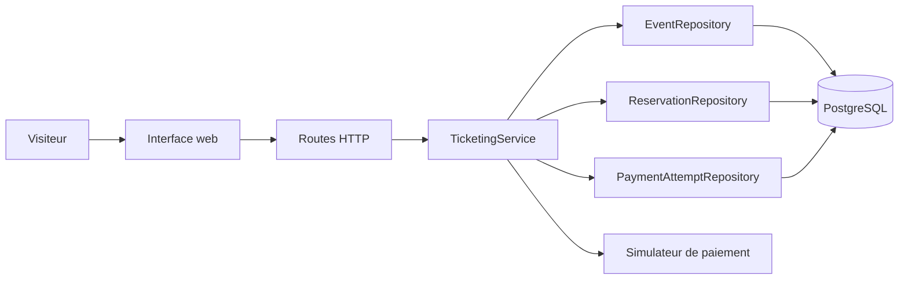

# Architecture initiale

## Vue d'ensemble

Un seul processus contient les routes, la logique et le simulateur. Une seule base contient les événements, les réservations et les tentatives de paiement. L'interface utilise la même origine HTTP.

`TicketingService` gère la consultation, la disponibilité, la réservation, l'expiration et le checkout. La concentration est volontaire : elle rend visible le coût d'une évolution métier et fournit une matière de refactoring. Le nom des fichiers ne constitue pas une carte des domaines métier.

## États observables

Une réservation naît `PENDING`. Un paiement accepté la passe à `CONFIRMED`; un refus certain à `FAILED`. Après expiration, elle devient `EXPIRED` et la place est libérée. Le simulateur peut aussi laisser une tentative `PENDING` quand le résultat n'est pas connu. Le client peut relire l'état via l'API.

La disponibilité affichée est calculée à partir des réservations encore actives. L'événement `atelier-une-place` permet d'observer l'effet de deux demandes simultanées.

## Limites connues et questions de travail

- La disponibilité est lue avant de créer la réservation, sans protection atomique de la capacité. Deux demandes simultanées peuvent occuper la dernière place. Le test `test:challenge` le rend visible.
- Plusieurs commandes ou un résultat de paiement incertain exigent une politique explicite de reprise et de dédoublonnage. Le code initial n'apporte pas cette garantie.
- L'expiration est déclenchée lors des requêtes, sans traitement périodique indépendant.
- Le processus et la base uniques simplifient le démarrage, mais concentrent la charge et les pannes.
- Les mesures de charge locales sont indicatives. Elles ne prouvent aucune capacité de production.

Le dépôt fournit les symptômes et des expériences reproductibles. Les solutions, les frontières fonctionnelles et les arbitrages sont à établir pendant les ateliers.
