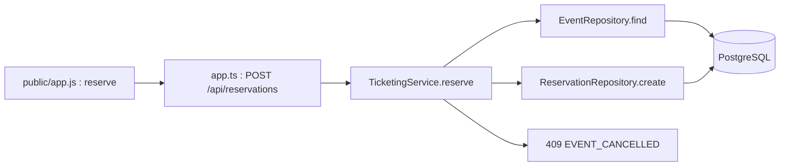

# TP 2 — Correction du diagnostic N-Layer

Sujet : [Notion — TP 2](https://www.notion.so/3efa4f0ae4ab81a6b59dee93581616a4).

## Parcours et décision



L'interface construit la demande ; la route traduit le corps HTTP et appelle le service ; le service décide ; les repositories exécutent le SQL et traduisent les lignes. Le paiement ne participe pas à la création d'une réservation. Au checkout, `TicketingService.checkout` crée une tentative via `PaymentAttemptRepository`, appelle `PaymentSimulator.run` puis persiste les états.

`EventView` représente les informations de l'événement et sa disponibilité calculée ; `ReservationView` décrit la réservation et son expiration ; `PaymentAttemptView` décrit un essai de paiement. Les types `*Row` des repositories représentent le stockage SQL, les objets Fastify représentent le transport HTTP.

La règle « un événement annulé ne reçoit plus de nouvelle réservation » appartient au service métier. Elle est évaluée sur l'événement relu au moment de la demande, après le contrôle d'existence et avant la disponibilité et l'insertion. Le SQL sait déjà stocker `CANCELLED` : aucune migration ni nouvelle couche n'est nécessaire. Le refus conserve le format JSON des erreurs et retourne `409 EVENT_CANCELLED`.

## Preuves et coût

Deux tests HTTP sont ajoutés dans `tests/api.test.ts` : événement annulé sans réservation ni paiement, et événement consulté ouvert puis annulé avant la demande. Le premier installe un événement de test annulé. Les 7 scénarios initiaux couvrent toujours le catalogue, l'événement ouvert, la capacité, les erreurs et les états de paiement.

Avant correction : **7 succès, 2 échecs**, car la route acceptait les deux demandes avec `201`. Après correction : **9 succès, 0 échec**.

```sh
docker compose --profile test run --build --rm test
```

Coût fonctionnel : **1 méthode de production modifiée**, `TicketingService.reserve`, **1 fichier de production**, **1 fichier de tests**, **2 nouveaux tests**, **aucune nouvelle dépendance**, **aucune migration**. Cette note et le plan de travail constituent les deux fichiers de documentation ajoutés.

## Dérive et limites

`TicketingService` concentre catalogue, disponibilité, expiration, réservation et paiement. Il dépend directement de trois repositories PostgreSQL et du simulateur concret. Tester une décision locale impose ici Fastify et PostgreSQL. Le N-Layer rend le parcours lisible, mais cette concentration fait converger plusieurs évolutions dans la même classe.

L'annulation survenant entre la lecture de l'événement et l'insertion n'est pas protégée par une transaction. La survente concurrente et les répétitions de paiement restent les défis suivants ; le test `test:challenge` demeure séparé et volontairement en échec sur l'invariant de capacité.

Trace IA : proposition retenue, contrôle local de `status` ; vérification, tests écrits et observés rouges avant la correction puis verts ; limite détectée, une validation applicative ne garantit pas l'atomicité.
