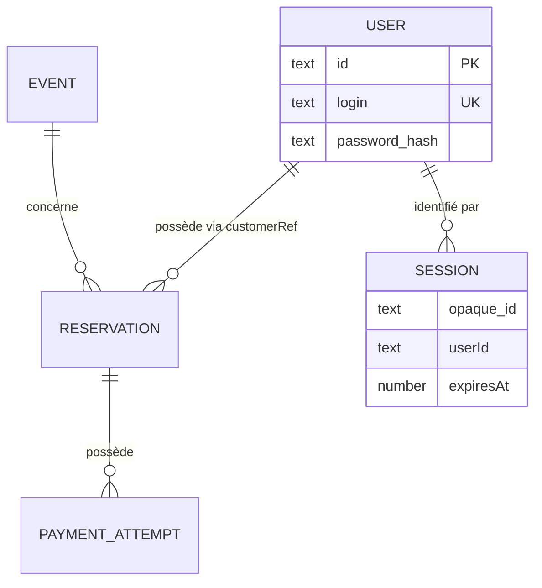
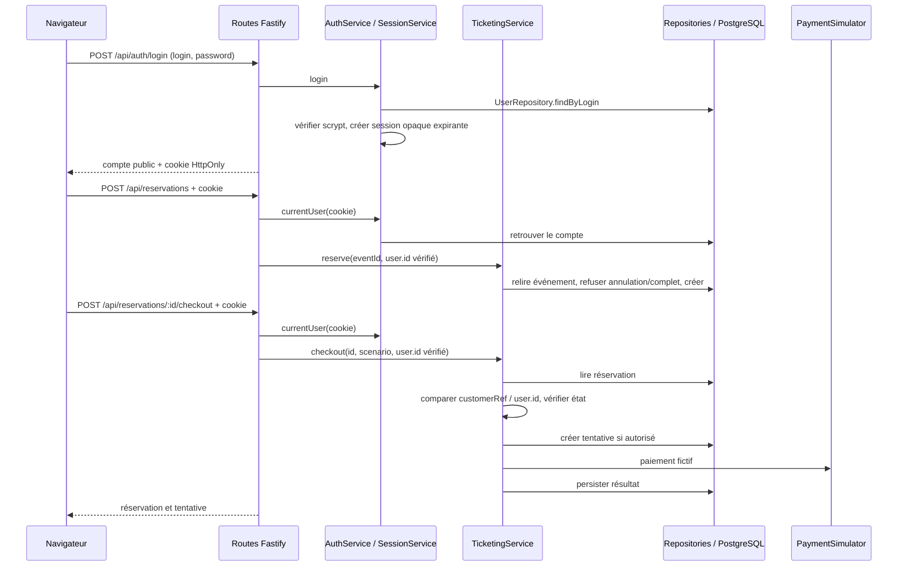

# TP 3 — Correction de l'achat connecté dans le N-Layer

Sujet : [Notion — TP 3](https://www.notion.so/3f0a4f0ae4ab817f8809efb4c58c68c7). Point de départ : branche `correction/tp2` et [règle d'annulation](tp2.md).

## Modèle avant / après

Avant : un visiteur fournit librement `customerRef`. Ce texte ne prouve aucune identité. Un événement possède des réservations, chacune peut avoir plusieurs tentatives de paiement.

Après : l'utilisateur est une nouvelle entité persistante ; la session est un mécanisme technique distinct, conservé dans le processus.



Les tables historiques sont conservées. `customerRef` contient désormais le `user.id` vérifié. Aucune identité fournie dans le corps HTTP n'est utilisée. Pas de clé étrangère ajoutée sur `customerRef` : lors de la création initiale des comptes, la migration préfixe les références historiques par `legacy:`. Ce marquage conserve la référence initiale et empêche une collision avec les nouveaux identifiants. Marquage et création de table sont atomiques ; les démarrages suivants préservent les auteurs authentifiés.

## Trajet de l'identité et décisions



L'authentification refuse une session absente, falsifiée ou expirée avec `401 AUTH_REQUIRED`. L'autorisation compare le propriétaire enregistré avec l'identité reconnue : `403 RESERVATION_FORBIDDEN` pour une réservation étrangère. Les routes n'acceptent pas un `userId` fourni dans le corps comme preuve.

La vérification de propriété précède aussi `expirePending` : une demande étrangère ne doit pas expirer la réservation avant de répondre 403. Après autorisation, l'expiration et les transitions historiques sont conservées. Le catalogue reste public et garde son mécanisme d'expiration du socle.

## Services, couches et fichiers touchés

| Élément | Responsabilité, données et dépendances |
| --- | --- |
| `public/index.html`, `public/app.js`, `public/app.css` | Connexion/déconnexion, compte courant, invitation à se connecter, cookie géré par le navigateur ; aucun auteur libre envoyé. Affichage d'un événement annulé. |
| `src/app.ts` | Transport HTTP et cookies via `@fastify/cookie` ; transmet l'identité vérifiée aux services ; traduit `AppError`. |
| `src/services/AuthService.ts` | Vérification des identifiants, réponse publique, session courante/déconnexion ; dépend de `UserRepository`, `SessionService` et du hachage concret. |
| `src/services/SessionService.ts` | Map de sessions opaques aléatoires de 256 bits, date d'expiration, révocation ; dépend de l'horloge et de `crypto.randomBytes`. Nettoyage des sessions expirées à la connexion. |
| `src/passwords.ts` | Hachage scrypt asynchrone, sel de 16 octets aléatoires, comparaison `timingSafeEqual` ; dépend de Node crypto. |
| `src/repositories/UserRepository.ts` | Lecture SQL des comptes et des hashes pour la connexion ; lecture publique par identifiant pour la session courante ; dépend de `pg.Pool`. |
| `src/services/TicketingService.ts` | Annulation, disponibilité, réservation, propriété, expiration et paiement ; dépend toujours des repositories concrets et du simulateur. |
| `src/types.ts` | Ajoute la représentation publique `UserView`, sans mot de passe ni hash. |
| `db/migrations/002_users.sql`, `src/migrate.ts`, `src/seedUsers.ts` | Création des comptes dans la même base ; exécution triée des migrations ; initialisation idempotente d'Alice et Bob avec hashes salés calculés au démarrage. |
| `src/server.ts`, `compose.yaml` | Configuration explicite `AUTH_COOKIE_SECURE=true` sous HTTPS. |
| `tests/api.test.ts` | Rejoue les 9 tests du TP 2 avec la vraie connexion avant les actions privées. |
| `tests/auth.test.ts`, `package.json` | Tests de droits, sessions et comptes ; tous les fichiers `*.test.ts` sont exécutés séquentiellement pour isoler les réinitialisations PostgreSQL. |
| `tests/frontend.test.ts` | Exécute le vrai script front dans un petit DOM simulé : déconnexion sans JSON vide et rejet des réponses privées tardives après déconnexion. |
| `tests/migration.test.ts` | Vérifie une collision d'identité historique et le second passage de migration dans un schéma temporaire isolé de `db-test`. |
| `tests/concurrency.challenge.ts` | Deux vrais comptes connectés ; le défi reste séparé des tests ordinaires. |
| `package-lock.json`, `README.md`, ce document, plan | Dépendance verrouillée, commandes, comptes de démonstration et justification. |

Cette évolution touche plusieurs couches parce qu'elle introduit une identité durable et un nouveau droit dans un parcours existant. L'interface seule ne peut pas assurer ce droit : un client HTTP peut ignorer les boutons et envoyer son propre corps.

## Tests et preuves

```sh
docker compose --profile test run --build --rm test
```

Les tests HTTP utilisent la vraie route de connexion, les vrais cookies, le vrai hachage et PostgreSQL `db-test`. Les réservations et tentatives sont vidées avant chaque scénario ; les tests obtiennent de nouvelles sessions propres. L'horloge injectée contrôle la session à 29 min 59,999 s puis à 30 min sans attente réelle. Les tests refusés comparent les lignes persistées avant/après et observent qu'aucun appel au vrai simulateur n'a eu lieu.

Première exécution avant implémentation : **9 succès, 10 échecs** (routes d'authentification absentes, réservation anonyme encore autorisée, table `users` absente). Première suite verte : **19 succès**. La revue a ajouté cinq tests de régression pour le front et la migration, observés en échec avant correction. Résultat final : **24 succès, 0 échec**. La compilation TypeScript et la construction des images Docker réussissent aussi.

La suite couvre catalogue public, connexion et données publiques, mauvais identifiants, auteur forgé, achat Alice, refus Bob sur lecture/paiement sans mutation, cookies falsifiés, expiration exacte, déconnexion, séparation des sessions, sels distincts et cookie `Secure`. Les états succès/refus/lenteur/expiration et les refus d'annulation du TP 2 restent couverts.

Le défi de concurrence authentifie Alice et Bob et vérifie qu'ils atteignent bien la décision de capacité. Il reste volontairement en échec sur la survente du socle : la correction de l'invariant appartient au TP 8.

Vérification dans le vrai navigateur : catalogue anonyme, formulaire Alice, réservation, achat confirmé et déconnexion avec retour au formulaire. Une réponse de réservation, consultation ou checkout arrivée après la déconnexion est ignorée par le front ; elle ne réaffiche pas les données de l'ancien compte.

## Difficultés observées et limites

Pour tester le refus Bob/Alice aujourd'hui, il faut démarrer Fastify et PostgreSQL, migrer les comptes, connecter deux personnes, créer la réservation et observer le simulateur concret. Le contrôle de propriété est dans le service, la lecture de cookie dans les routes, le hachage dans un helper concret. Aucun port Clean n'est introduit : le TP 4 aura précisément pour matière ces dépendances.

Les sessions disparaissent au redémarrage et ne sont pas partagées entre instances. Leur expiration n'est pas prolongée à la lecture. Le cookie ne contient ni mot de passe ni identifiant utilisateur accepté directement ; le serveur valide toujours son association au compte. Connexion, réponse `me` et toutes les réponses métier omettent le hash.

Les comptes sont publics et fictifs, sans inscription ni récupération de mot de passe. La concurrence sur les places, l'idempotence du checkout et les reprises d'un paiement incertain restent les exercices suivants. Le catalogue peut encore provoquer des écritures d'expiration, comme dans le socle ; la séparation CQRS viendra au TP 5.

## Trace IA et sources vérifiées

Propositions retenues : garder le N-Layer et `customerRef`, session opaque en mémoire, deux comptes persistants et scrypt salé. Vérifications : sujets Notion et notes des supports actuels, tests rouges avant implémentation puis suite verte sur PostgreSQL. Limite détectée pendant la conception : expirer les réservations avant de vérifier le propriétaire produirait un effet lors d'un accès refusé ; l'ordre a donc été corrigé et fait l'objet d'un test sur une réservation étrangère expirée.

La revue indépendante a relevé une collision possible entre référence historique et nouvel identifiant, traitée par le marquage `legacy:` et son test de migration rejouée, ainsi que les réponses privées tardives après déconnexion, traitées par un compteur de changement de session. Le test navigateur a révélé un POST de déconnexion envoyé avec `Content-Type: application/json` sans corps : le front n'ajoute désormais cet en-tête que pour une demande avec corps. Ces trois corrections ont leurs tests de régression.

Références techniques : [plugin officiel Fastify cookie](https://github.com/fastify/fastify-cookie), [crypto Node.js 24](https://nodejs.org/docs/latest-v24.x/api/crypto.html), [tests Fastify](https://fastify.dev/docs/latest/Guides/Testing/).
