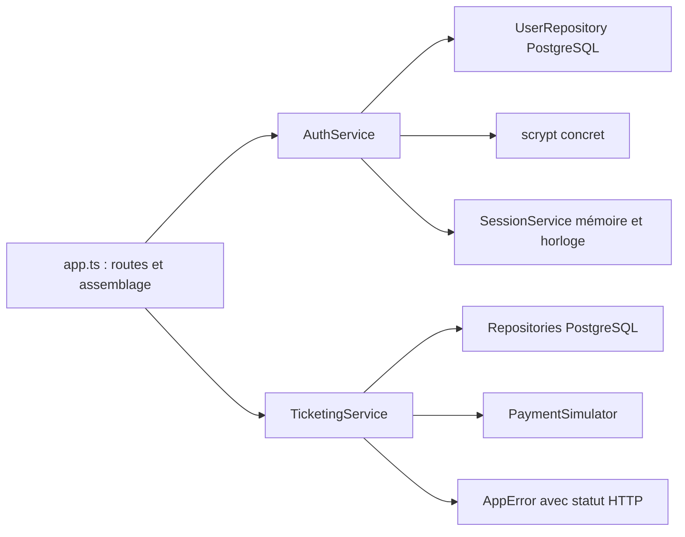
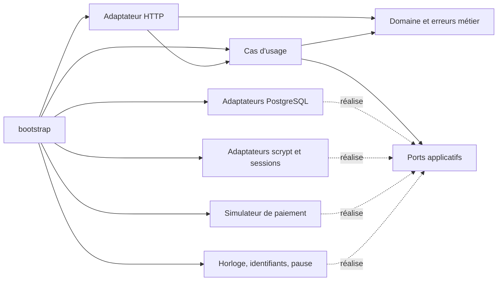

# TP 4 — Correction de la refactorisation Clean

Sujet : [Notion — TP 4](https://www.notion.so/3efa4f0ae4ab813497bce09a723ec0db), consulté le 27 octobre 2026. Branche : `correction/tp4`, issue de `correction/tp3` au commit `0a22ed1`.

Cette correction reprend tous les parcours du TP 3. Le front, les routes et leurs corps JSON, les réponses, les cookies, les paramètres, les migrations et les données restent les mêmes. Le processus et la base restent uniques. L'organisation évolue pour tester les décisions avec des données en mémoire.

## Inventaire et diagnostic de départ

| Parcours | Entrée et décisions | Données et effets de la référence TP 3 |
| --- | --- | --- |
| Connexion | Login/mot de passe, refus d'identifiants incorrects | Lecture utilisateur, vérification scrypt, nettoyage des sessions expirées, création du token, révocation de l'ancien token, cookie HTTP |
| Compte courant | Cookie opaque, session existante et non expirée | Lecture session et utilisateur, aucune prolongation |
| Déconnexion | Cookie éventuellement absent | Révocation de cette session et suppression du cookie |
| Catalogue et détail | Accès public, événement existant pour le détail | Expiration des réservations puis lecture des événements et de leur disponibilité |
| Réservation | Identité vérifiée, entrée valide, événement existant, ouvert et disponible | Expiration, pause pédagogique éventuelle, insertion `PENDING` avec l'auteur vérifié |
| Détail privé | Identité, identifiant de réservation et propriété | Après autorisation : expiration, relecture de réservation et lecture des tentatives |
| Checkout | Identité, identifiant, propriété, scénario et état payable | Expiration, création de tentative, paiement fictif, transitions ou attente |

Trois difficultés observées dans le code du TP 3 :

1. `TicketingService.checkout` dépend des repositories PostgreSQL et du simulateur concret. Prouver le refus Bob/Alice impose une base, Fastify et deux connexions HTTP.
2. `AuthService.login` importe la vérification concrète du hash ; `SessionService` réunit le stockage mémoire, le tirage aléatoire et l'expiration. Tester la validité ne devrait pas imposer tous ces détails.
3. `AppError` contient déjà `statusCode`. La décision métier choisit donc un détail HTTP, tandis que `app.ts` construit les composants et définit aussi les routes.

## Avant et après

Avant, les flèches représentent les dépendances concrètes du code du TP 3 :



Après, les flèches pleines représentent les imports ; les liens pointillés représentent les ports réalisés :



`src/domain/models.ts` contient des données simples. `reservationRules.ts` porte l'identité requise, la propriété, l'événement réservable, l'état payable, le scénario valide et les transitions liées au résultat du paiement. `BusinessError` contient un code et un message, sans statut HTTP.

Les cas d'usage orchestrent ces règles et les ports. Les cookies et statuts restent dans `adapters/http`, le SQL dans `adapters/postgres`, le hash et la Map des sessions dans `adapters/auth`. La date limite de session est décidée par le parcours applicatif ; le stockage mémoire ne décide pas si une session autorise une requête.

## Cas d'usage et besoins réels

| Cas d'usage | Ports utilisés et responsabilité |
| --- | --- |
| `CheckoutReservation.execute(id, userId, scenario)` | Lire/expirer/modifier une réservation ; créer/modifier une tentative ; appeler `PaymentGateway` ; obtenir un identifiant. Refuser avant les effets de paiement. |
| `ReservePlace.execute(eventId, userId)` | Lire l'événement, expirer/créer une réservation, générer son identifiant, lire l'horloge et réaliser la pause pédagogique. Enregistrer le propriétaire vérifié. |
| `GetReservation.execute(id, userId)` | Lire/expirer la réservation et lire ses tentatives après vérification du propriétaire. |
| `Login.execute(login, password, previousSessionId?)` | Lire le compte par login, vérifier le secret, nettoyer/créer/révoquer une session, obtenir un token opaque et lire l'horloge. Retourner seulement les données publiques du compte. |
| `GetCurrentUser.execute(sessionId)` | Lire une session et un utilisateur avec une horloge. Refuser l'absence, l'expiration ou le compte disparu ; ne pas prolonger la session. |
| `Logout.execute(sessionId)` | Révoquer une session ; l'absence de cookie reste acceptée. |
| `ListEvents.execute()` | Expirer les réservations comme au TP 3 puis lire le catalogue, sans identité. |
| `GetEvent.execute(id)` | Même expiration puis lecture du détail ; refuser l'événement absent. |

Les dix interfaces de `application/ports.ts` correspondent aux opérations réellement utilisées : `EventStore`, `ReservationStore`, `PaymentAttemptStore`, `PaymentGateway`, `UserStore`, `PasswordVerifier`, `SessionStore`, `Clock`, `IdGenerator`, `Pause`. Les constructeurs utilisent `Pick<Port, ...>` quand un parcours n'utilise qu'une partie des opérations. Ils ne reçoivent donc pas de dépendances de paiement pour une simple consultation.

`UseCases` décrit les huit entrées utilisées par HTTP. Il ne contient ni bus ni distinction commande/requête. Les lectures conservent les effets d'expiration existants ; leur séparation sera le TP 5.

## Adaptateurs et assemblage

Les quatre repositories SQL réalisent explicitement les ports de stockage et traduisent leurs lignes. `UserRepository` traduit `password_hash` en `passwordHash` à la frontière ; l'application ne connaît plus ce nom de colonne.

`ScryptPasswordVerifier` appelle le même helper scrypt qu'au TP 3. Le hash factice utilisé pour un login inconnu est désormais un détail de cet adaptateur. `MemorySessionStore` stocke des sessions avec leur expiration, les retrouve, les retire et supprime les expirées à la connexion. Les générateurs concrets utilisent toujours un UUID pour les réservations/tentatives et 32 octets aléatoires pour les sessions.

`bootstrap/createUseCases.ts` construit une seule instance de chaque stockage partagé et les injecte dans les parcours. Une même Map sert ainsi à la connexion, au compte courant et à la déconnexion. L'horloge contrôlable du paramètre `AuthConfig.now` garde son périmètre de session du TP 3 ; la création de réservation garde l'horloge système en intégration.

`adapters/http/buildHttpApp.ts` lit les cookies et le corps, appelle le cas d'usage, pose/efface les cookies et traduit les erreurs avec `businessErrors.ts`. L'authentification précède les parcours privés ; les identifiants envoyés comme auteur dans le corps restent ignorés. `bootstrap/buildApp.ts` branche aussi la vérification de santé PostgreSQL.

Les anciens `TicketingService`, `AuthService`, `SessionService` et `AppError` ont disparu. `src/app.ts`, `src/types.ts` et `src/integrations/PaymentSimulator.ts` sont des réexports de compatibilité, sans règles dupliquées. Ils permettent de conserver les imports et les tests HTTP du TP 3, y compris l'observation du prototype du simulateur.

## Commits et preuves

| Passage | Commit | Résultat de la suite complète |
| --- | --- | --- |
| Référence TP 3 | `0a22ed1` | 24 tests |
| Checkout et règles | `54d0527` | 36 tests |
| Réservation et détail privé | `7cfc40a` | 49 tests |
| Connexion et sessions | `c8bdef6` | 63 tests |
| Catalogue, adaptateurs et assemblage | `5cb70c9` | 78 tests |

Les tests de chaque nouveau parcours sont ajoutés avant son extraction. Ils construisent des petits stockages en mémoire et contrôlent les effets. Par exemple, Bob ne peut pas déclencher l'expiration d'une réservation étrangère, créer une tentative ou appeler le paiement ; un checkout expiré ou fermé ne crée pas de tentative ; chaque résultat de paiement produit les mêmes états et le même ordre d'écriture. L'expiration est vérifiée au seuil exact avec une horloge contrôlée.

Les **43 tests en mémoire** n'importent ni serveur HTTP, ni PostgreSQL, ni adaptateur concret. Ils s'exécutent sans `DATABASE_URL` :

```sh
npm ci
npm run test:unit
```

Les **24 tests du TP 3 sont inchangés**, y compris l'authentification réelle, les cookies, le front, la migration, l'auteur forgé et les refus sans mutation. **11 tests supplémentaires de l'adaptateur HTTP** vérifient la traduction de tous les codes métier et le masquage des erreurs techniques. Pour tout exécuter avec PostgreSQL isolé :

```sh
docker compose --profile test run --build --rm test
```

La compilation TypeScript et le contrôle des dépendances complètent les tests :

```sh
npm run build
npm run check:architecture
```

Le contrôle parcourt les imports du domaine et de l'application avec le scanner de TypeScript 7 installé dans le dépôt, y compris les réexports et appels `import`/`require`. Sur cette correction : **3 fichiers domaine, 10 fichiers application, 33 imports internes autorisés**. Les imports extérieurs à ces couches sont refusés. Cela vérifie la direction des dépendances ; les tests de comportement vérifient la justesse des décisions.

La validation Docker finale a utilisé un export exact de l'index Git hors OneDrive : le moteur local refusait de lire un fichier déplacé avec un attribut de fichier cloud dans le contexte original. Le même Dockerfile et la même configuration Compose y construisent et testent l'application. Ce contournement de validation ne modifie aucun fichier livré.

L'image d'exécution a aussi été démarrée avec Compose et sa santé vérifiée. Un parcours HTTP sur le vrai port de l'application confirme : catalogue public, connexion Alice, réservation, achat `CONFIRMED` avec tentative `SUCCEEDED`, refus de Bob `403`, déconnexion `204`, puis refus `401` lors de la réutilisation de l'ancien cookie. La revue indépendante n'a relevé aucun problème de code ni de contrat.

## Gains, coûts et trois changements possibles

Le refus de propriété, l'expiration d'une session et les transitions de paiement sont maintenant prouvés sans infrastructure. C'est un gain mesuré par les 43 tests indépendants. Les tests HTTP restent nécessaires : un faux vérificateur ne prouve ni scrypt, ni le cookie, ni le SQL.

Le coût est visible : les sources TypeScript passent de **15 à 33 fichiers**, avec **8 cas d'usage**, **10 interfaces de ports**, **11 fichiers d'adaptateurs** et un assemblage explicite. Les tests doivent maintenir des faux fidèles aux opérations utilisées. Cette structure ne prouve pas à elle seule un gain de débit ou une meilleure disponibilité.

| Changement envisagé | Fichiers concernés et preuves conservées |
| --- | --- |
| Remplacer PostgreSQL | Nouvelles réalisations des quatre ports de stockage et mise à jour de `bootstrap/createUseCases.ts`, plus migrations/configuration techniques ; les 43 tests métier/applicatifs restent utilisables. |
| Remplacer la connexion technique | Adaptateurs de mot de passe/session, générateur de token et adaptation HTTP/configuration selon le mécanisme choisi ; les règles de propriété restent dans le domaine et leurs tests restent utilisables. Un changement du contrat fonctionnel demanderait de nouveaux cas d'usage. |
| Remplacer le simulateur de paiement | Nouvelle réalisation de `PaymentGateway` et injection dans le bootstrap ; les tests du checkout en mémoire restent utilisables, avec des tests de contrat/integration pour la nouvelle réalisation. |

## Limites conservées et trace IA

Clean ne résout pas la survente, l'idempotence du checkout, les écritures de paiement non atomiques ni un résultat incertain. Le défi de concurrence reste séparé et volontairement rouge pour le TP 8. Les sessions mémoire disparaissent au redémarrage et ne sont pas partagées entre instances.

Le catalogue et les détails peuvent encore provoquer des écritures d'expiration. Les erreurs techniques sont toujours traduites en `503`, y compris certaines erreurs de parsing HTTP du socle : ce comportement est relevé séparément et conservé pour ne pas mélanger une correction fonctionnelle au TP 4.

Proposition IA retenue : ports définis selon les parcours, règles simples plutôt qu'une classe par donnée, extraction progressive et tests de chaque intention. Proposition corrigée : conserver `AppError` dans le cœur aurait maintenu un couplage HTTP ; `BusinessError` et la table de traduction sont séparés. Le scanner a été adapté à l'API de TypeScript 7 réellement installée, après détection de l'absence de l'ancienne API de parsing. Vérification : tests de comportement, contrats HTTP conservés, contrôle des imports, compilation et revue indépendante.
