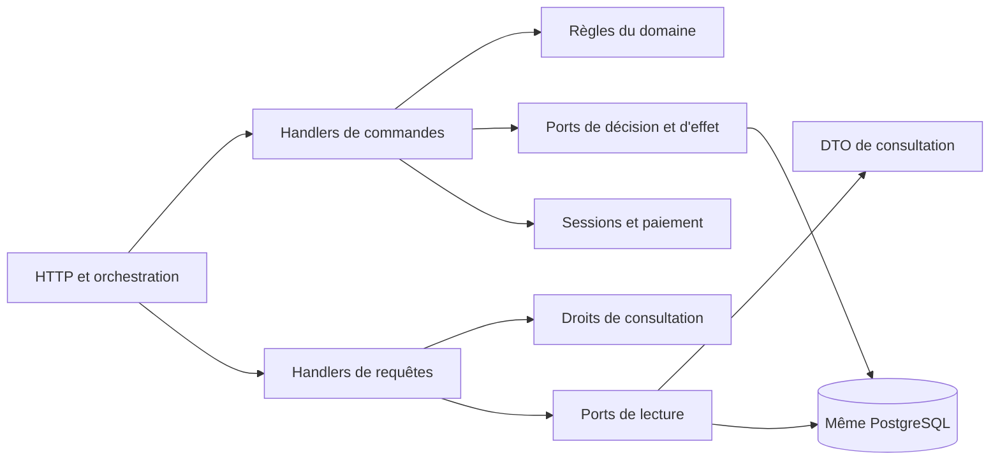

# TP 5 — Correction CQRS de toute la billetterie

Sujet : [Notion — TP 5](https://www.notion.so/3efa4f0ae4ab81c7b68dce41cf02ccda), consulté le 27 octobre 2026. Branche : `correction/tp5`, issue de `correction/tp4` au commit `68176aa`.

Le TP 4 isolait les décisions des détails techniques avec Clean Architecture. Ce TP distingue leurs intentions et leurs effets : **cinq commandes**, dont une maintenance interne, et **quatre requêtes sans écriture**. Le monolithe garde un seul processus, PostgreSQL, les comptes et les sessions mémoire du TP 4.

## Inventaire des intentions et contrats

| Route / déclenchement | Traitement | Demande interne | Résultat et effets |
| --- | --- | --- | --- |
| `POST /api/auth/login` | Commande `LoginUserHandler` | `login`, `password`, `previousSessionId?` | `user` public et `sessionId` réservé à l'adaptateur HTTP ; vérifier le secret, nettoyer les sessions expirées, créer une session et révoquer l'ancien token après succès |
| `POST /api/auth/logout` | Commande `LogoutUserHandler` | `sessionId?` | Aucun résultat métier ; révoquer la session. HTTP efface le cookie et retourne 204 |
| `POST /api/reservations` | Commande `ReservePlaceHandler` | `eventId`, `actorId` vérifié | Réservation `PENDING` ; expirer les anciennes réservations, relire l'événement autoritaire, vérifier annulation/capacité et enregistrer l'auteur |
| `POST /api/reservations/:id/checkout` | Commande `CheckoutReservationHandler` | `reservationId`, `actorId`, `scenario` | Réservation et tentative ; vérifier les droits avant maintenance, puis l'état courant avant tentative/paiement/transitions |
| `GET /api/auth/me` et authentification des routes privées | Requête `GetCurrentUserHandler` | `sessionId?` | `UserDto` avec seulement `id` et `login` ; lire session/compte et refuser l'expiration sans suppression ni prolongation |
| `GET /api/events` | Requête `ListEventsHandler` | Objet vide | Liste de `EventDto` publics ; aucune écriture dans le handler |
| `GET /api/events/:id` | Requête `GetEventHandler` | `eventId` | `EventDto`, ou `EVENT_NOT_FOUND` ; aucune écriture dans le handler |
| `GET /api/reservations/:id` | Requête `GetMyReservationHandler` | `reservationId`, `actorId` | `ReservationDetailsDto` avec les seules tentatives autorisées ; propriété vérifiée sans mutation |
| Routes de consultation et commandes de réservation/achat | Commande interne `ExpirePendingReservationsHandler` | Objet vide | Aucun résultat ; expirer uniquement les réservations `PENDING` arrivées à échéance |

Les contrats HTTP restent ceux du TP 4. L'adaptateur lit le cookie, appelle `GetCurrentUser` et transmet son identifiant à `actorId`. Un auteur envoyé dans le corps reste ignoré. Les données de connexion, les cookies et les objets Fastify ne sont pas fournis aux handlers de réservation ou de paiement.

Les entrées, résultats et handlers d'une intention sont regroupés dans son fichier, par exemple :

```ts
export interface ReservePlaceCommand {
  eventId: string;
  actorId: string | undefined;
}

export type ReservePlaceResult = Reservation;
```

`ReservePlaceHandler` réalise `CommandHandler<ReservePlaceCommand, ReservePlaceResult>` ; sa méthode `execute(command)` valide l'identité et relit l'état autoritaire avant d'agir.

Une commande peut consulter des données et retourner un résultat. `LoginUser` et `CheckoutReservation` sont bien des commandes : ils produisent une session ou un effet de paiement. Les fichiers statiques, `/health`, le hachage et les méthodes internes des repositories ne deviennent pas des intentions supplémentaires.

## Organisation des fichiers

```text
src/application/
  Application.ts
  commands/
    ReservePlace.ts
    CheckoutReservation.ts
    LoginUser.ts
    LogoutUser.ts
    ExpirePendingReservations.ts
  queries/
    GetEvent.ts
    ListEvents.ts
    GetMyReservation.ts
    GetCurrentUser.ts
  dto/
    EventDto.ts
    ReservationDto.ts
    ReservationDetailsDto.ts
    PaymentAttemptDto.ts
    UserDto.ts
  ports/                  un fichier par contrat
src/domain/models/        modèles du TP 4 conservés, un fichier chacun
src/adapters/             HTTP, PostgreSQL, sessions, scrypt et paiement
src/bootstrap/
  createApplication.ts
  buildApp.ts
  config.ts
```

`Application` expose explicitement `commands` et `queries`. Les interfaces génériques `CommandHandler` et `QueryHandler` définissent seulement `execute(demande)`. Il s'agit de contrats TypeScript et d'un assemblage manuel ; aucun bus ni conteneur supplémentaire n'est introduit.

Les huit anciens fichiers de cas d'usage et l'ancien agrégat `UseCases` ont été supprimés. Le bootstrap construit les nouveaux handlers et partage les mêmes instances de repositories, de Map de sessions et de maintenance. Aucun chemin ancien ne garde les décisions en parallèle.

## Ports de lecture et ports de décision/effet

| Côté | Ports et opérations exposées |
| --- | --- |
| Consultation des événements | `EventReader.list/find` fournit les données de consultation |
| Consultation privée | `ReservationReader.find` et `PaymentAttemptReader.listForReservation` |
| Utilisateur courant | `SessionReader.find`, `UserReader.findById` et `Clock.now` |
| Réservation et checkout | `EventStore.find` lit l'état autoritaire ; `ReservationStore.find/create/changeStatus`, `PaymentAttemptStore.create/changeStatus` et `PaymentGateway.run` réalisent les décisions et effets |
| Connexion/déconnexion | `UserStore.findByLogin`, `PasswordVerifier.verify`, `SessionStore.save/removeExpired/revoke` et `SessionRevoker.revoke` |
| Maintenance et outils | `PendingReservationExpirer.expirePending`, `IdGenerator.next`, `Pause.wait`, `Clock.now` |
| Entrées des handlers | `CommandHandler` et `QueryHandler` |

Les dix-neuf ports sont définis dans dix-neuf fichiers. Les requêtes reçoivent des contrats nommés de lecture ; elles ne disposent pas des opérations de création, changement d'état, révocation ou paiement.

Un adaptateur peut réaliser plusieurs ports sur le même stockage. `EventRepository` réalise `EventStore` et `EventReader`, `ReservationRepository` réalise le stockage des commandes, la lecture et l'expiration, et les autres adaptateurs suivent le même principe. Le SQL existant reste conservé. Les données d'un événement ou d'une réservation ont encore des structures proches sur les deux chemins ; leur séparation logique ne crée pas une seconde base ni un modèle distribué.

Les cinq DTO sont des contrats de consultation distincts des modèles de domaine. Les propriétés sont `readonly`, et les handlers construisent de nouveaux objets en sélectionnant explicitement leurs champs. `GetMyReservation` projette aussi chaque tentative. Même si un adaptateur fournit un champ interne ou une méthode supplémentaire, ceux-ci ne se retrouvent pas dans le résultat. `UserDto` ne contient aucun hash ni secret de session.

## L'expiration rendue explicite

Au TP 4, le catalogue et les détails déclenchaient `expirePending` dans leurs cas d'usage. Ce sont des écritures PostgreSQL : déplacer les classes dans un dossier `queries` aurait laissé le défaut intact.

Le propriétaire de cette écriture est désormais `ExpirePendingReservationsHandler`. Les routes publiques conservent le comportement acquis :

```text
GET catalogue ou détail d'événement
  → commande ExpirePendingReservations
  → requête ListEvents ou GetEvent
  → réponse HTTP
```

La consultation privée demande une précaution supplémentaire :

```text
GET détail de réservation
  → requête GetCurrentUser
  → requête GetMyReservation : vérification des droits, résultat provisoire interne
  → commande ExpirePendingReservations
  → requête GetMyReservation : résultat à retourner après maintenance
```

La première requête empêche un utilisateur étranger d'expirer une réservation avant de recevoir 403. La seconde garantit le retour de l'état persisté après maintenance. Cette organisation ajoute une lecture des tentatives ; elle est conservée explicitement pour respecter les droits et les effets du TP 4. Les erreurs d'identité, d'identifiant ou de propriété interviennent avant la maintenance.

Un handler de requête appelé directement peut donc retourner une réservation encore persistée `PENDING`, dont `expiresAt` est dépassé : il fournit un état enregistré et n'effectue pas le nettoyage. C'est la maintenance ou une commande métier qui fait évoluer cet état. La route privée retourne ensuite l'état actualisé, comme auparavant.

Les commandes `ReservePlace` et `CheckoutReservation` réutilisent la même commande interne avant leur décision de création ou de paiement. Le checkout vérifie d'abord le propriétaire et le scénario pour conserver l'ordre des refus et l'absence d'effets. La lecture d'une session expirée, elle, répond `AUTH_REQUIRED` sans retirer ou prolonger la session ; le nettoyage des sessions reste un effet de la connexion, comme au TP 4.

## Les deux chemins et les dépendances



Ces flèches représentent les appels. Les imports gardent la direction Clean : les ports appartiennent à l'application, les adaptateurs les réalisent et le bootstrap choisit les implémentations. Le domaine ne dépend pas de l'application ; domaine et application n'importent ni Fastify, ni PostgreSQL, ni cookie, ni SDK technique.

`npm run check:architecture` contrôle aussi les dépendances des requêtes : seules les règles du domaine, les DTO, les autres requêtes et les ports de lecture identifiés sont autorisés. Les DTO ne peuvent pas dépendre d'une orchestration. Un essai négatif introduisant temporairement un import de `ReservationStore` dans une requête a été refusé, puis le fichier d'essai a été retiré.

## Tests et passages de refactorisation

| Passage | Commit de référence | Résultat complet |
| --- | --- | --- |
| Départ TP 4 | `68176aa` | 78 tests réussis |
| Première paire et maintenance | `979e63a` | 81 tests réussis |
| Checkout et détail privé | `010a32f` | 84 tests réussis |
| Comptes et catalogue | `3a48c32` | 88 tests réussis |
| Preuves HTTP et PostgreSQL | `3602f84` | 96 tests réussis |

Les nouveaux tests de lecture ont d'abord échoué sur les cas d'usage du TP 4 : expiration cachée et retour de champs supplémentaires. Après extraction, ils vérifient les DTO, la copie des données et l'absence d'effets. Les tests des commandes conservent les garanties et les transitions déjà établies.

Deux scénarios séquentiels montrent pourquoi une consultation n'est pas une garantie :

1. L'événement est consulté `OPEN` avec une place, puis son état autoritaire est changé en `CANCELLED`. `ReservePlace` relit cet état et refuse sans insertion. Le DTO antérieur reste une simple photographie.
2. Une réservation est consultée `PENDING`, puis l'horloge atteint sa limite. `CheckoutReservation` déclenche l'expiration et refuse sans tentative ni appel au paiement.

La suite comprend **53 tests de handlers en mémoire**, **24 tests historiques inchangés** d'API/authentification/front/migration, **11 tests de traduction d'erreurs** dont seul le montage interne a été adapté, et **8 nouveaux tests HTTP/PostgreSQL**. Ces derniers vérifient l'ordre maintenance/lecture, les refus sans maintenance, la relecture privée et l'expiration des seules `PENDING` échues dans la vraie base de test.

```sh
npm ci
npm run test:unit
npm run build
npm run check:architecture
docker compose --profile test run --build --rm test
```

Résultats : **96 tests ordinaires réussis, 0 échec** ; compilation réussie ; **12 fichiers domaine, 34 fichiers application, 94 imports internes autorisés**. Les fichiers du front, migrations, données, configuration Compose et Dockerfile sont identiques à ceux du TP 4. La validation Docker utilise un export Git identique hors OneDrive pour éviter le défaut local de lecture des fichiers cloud déjà relevé au TP 4.

La revue indépendante a confirmé les frontières Clean/CQRS, l'ordre des effets, les DTO et l'assemblage partagé, sans relever de problème de code. Elle a aussi rejoué les 53 tests en mémoire, les 16 tests d'adaptateur HTTP et la compilation sans émission de fichiers.

L'image d'exécution a été démarrée avec Compose et vérifiée sur son vrai port : santé OK, catalogue public, connexion Alice, réservation, paiement `CONFIRMED`/`SUCCEEDED`, accès de Bob refusé 403, déconnexion 204 puis ancien cookie refusé 401. Le défi séparé a également été rejoué : deux demandes sont encore acceptées pour une place, échec attendu pour le travail de concurrence du TP 8.

## Gains, coûts et limites

Un changement de règle de réservation se fait dans `ReservePlaceHandler` et les règles du domaine, puis se prouve avec les tests de commande. Un changement de présentation des données du catalogue, par exemple le libellé du titre retourné, concerne `ListEventsHandler` et son contrat de résultat ; il n'ajoute pas de règle à la réservation. Les modèles de domaine restent communs aux décisions, et certaines structures de DTO/SQL sont encore partagées entre lectures. Ajouter des données nouvelles peut donc nécessiter de modifier le port de lecture et l'adaptateur commun ; la séparation n'élimine pas tous les changements transversaux.

Le coût est de **66 fichiers TypeScript de production**, contre 51 au TP 4 : **9 handlers**, **5 DTO** et **19 ports**, avec leurs contrats explicites. Le gain prouvé est la lecture sans mutation et l'autorité de chaque effet. Pour ce petit domaine, l'organisation d'une simple déconnexion pourrait rester plus courte ; la généralisation est ici pédagogique.

Le système ne comporte ni broker, ni Event Sourcing, ni projection asynchrone, ni extraction réseau. CQRS ne corrige ni la survente concurrente, ni l'idempotence ou les écritures partielles de paiement. Le défi de concurrence reste séparé et volontairement en échec pour le TP 8. Les sessions restent en mémoire et disparaissent au redémarrage. Le nettoyage dans les routes GET reste une dette héritée explicitement documentée ; aucun planificateur n'est ajouté.

Trace IA : proposition retenue, handlers aux demandes explicites et ports de lecture nommés, en conservant un fichier par port/modèle. Proposition corrigée, placer la maintenance avant toute lecture privée aurait produit une écriture lors d'un refus Bob/Alice ; l'autorisation est donc lue avant maintenance et le résultat relu ensuite. Les tests HTTP historiques et les nouveaux tests d'ordre des effets vérifient ce choix.
