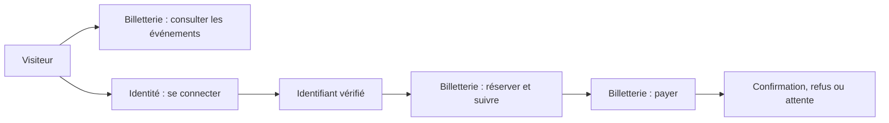
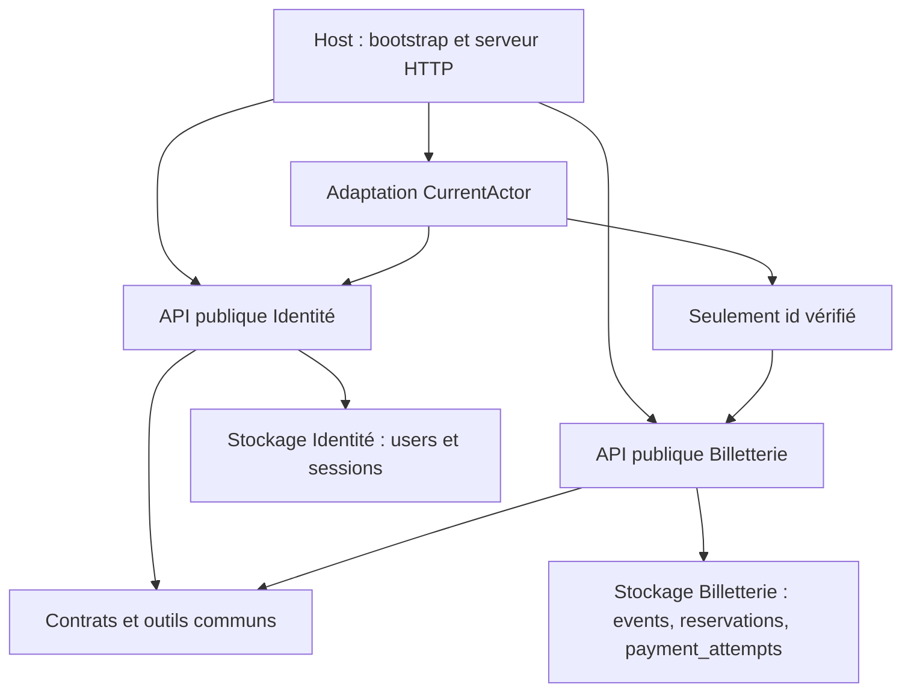

# TP 6 — Organiser le monolithe en vertical slices

Sujet : [Notion — TP 6](https://www.notion.so/3efa4f0ae4ab81ceb5a3fdc8b0a1437a), consulté le 27 octobre 2026. Branche : `correction/tp6`, issue de `correction/tp5` au commit `557127d`.

Le regroupement suit deux capacités métier : **Identité** et **Billetterie**. Chaque module contient ses entrées HTTP, commandes, requêtes, modèles, ports, adaptateurs et tests. L'application garde un seul processus, un seul déploiement et la même base PostgreSQL. Les contrats HTTP et le formulaire de connexion restent identiques.

## Carte fonctionnelle révisée

| Capacité et résultat observable | Règles possédées | Modèles et données possédés |
| --- | --- | --- |
| Identité : reconnaître un compte, ouvrir une session, retrouver l'utilisateur courant et le déconnecter | Vérifier le secret ; créer un token opaque ; durée fixe de session ; refuser une session absente/expirée ; révoquer la session | `User`, `UserAccount`, `Session` ; table `users` et Map de sessions |
| Billetterie : consulter les places, réserver, payer et suivre une réservation | Refuser un événement annulé/complet ; retenir une place temporairement ; vérifier le propriétaire ; expirer une attente ; interpréter le paiement et changer les états | `Event`, `Reservation`, `PaymentAttempt` et leurs états ; tables `events`, `reservations`, `payment_attempts` |

La consultation du catalogue est publique. Réserver, suivre une réservation et payer demandent un acteur reconnu par Identité. L'autorisation de consulter ou payer une réservation appartient à Billetterie : elle compare cet identifiant au propriétaire enregistré.



### Frontières discutées

Catalogue, réservation et paiement sont des sous-capacités identifiables. Les séparer maintenant multiplierait les échanges nécessaires à une seule décision : la disponibilité dépend des réservations, l'expiration restitue une place et le résultat du paiement change la réservation. Ils restent donc dans Billetterie, avec des handlers et ports distincts. Ce choix est révisable si leurs règles ou rythmes d'évolution divergent.

Identité possède des règles et un cycle de vie différents. La billetterie consomme un identifiant vérifié et n'a besoin ni du login, ni du hash, ni de la session. La frontière ne nécessite aucun accès aux données privées de ce module. Deux modules suffisent ici à éprouver le découpage demandé ; leur nom ne préjuge pas des services d'un futur TP.

## Organisation et API publiques

```text
src/modules/
  identity/
    index.ts                  factory, routes, types publics
    setup.ts                  initialisation des comptes pour migrate.ts
    contracts/                IdentityApi et configuration
    application/
      commands/               LoginUser, LogoutUser
      queries/                GetCurrentUser
      dto/                    UserDto
      ports/                  un fichier par port
    domain/models/            User, UserAccount, Session
    adapters/                 HTTP, PostgreSQL, scrypt, session, identifiants
    bootstrap/                assemblage et durée de vie des instances
    tests/unit/               décisions de connexion et lecture de session
  ticketing/
    index.ts                  factory, routes, types publics
    testing.ts                compatibilité du simulateur dans les tests historiques
    contracts/                TicketingApi, TicketingConfig, CurrentActor
    application/
      commands/               ReservePlace, CheckoutReservation, ExpirePendingReservations
      queries/                ListEvents, GetEvent, GetMyReservation
      dto/                    quatre DTO de consultation
      ports/                  un fichier par port
    domain/                   modèles séparés et règles de réservation
    adapters/                 HTTP, PostgreSQL, paiement et temporisation
    bootstrap/                assemblage local
    tests/unit/               décisions et lectures en mémoire
    tests/integration/        expiration persistée avec PostgreSQL
```

Les 19 ports applicatifs du TP 5 restent définis chacun dans un fichier : six dans Identité, neuf dans Billetterie et quatre contrats génériques dans `shared/application/ports` (`Clock`, `IdGenerator`, `CommandHandler`, `QueryHandler`). `CurrentActor` est un contrat d'intégration supplémentaire propre à Billetterie.

`shared` contient neuf sources : ces quatre contrats, l'erreur et son vocabulaire existant, l'horloge système et trois petits outils HTTP. Aucune règle de réservation, classe utilisateur, session ou repository n'y est placé. Le code de composition et les façades historiques occupent dix sources ; Identité en compte 26 et Billetterie 39, soit 84 sources de production au total. L'encapsulation ajoute des contrats et des factories, mais les décisions métier ne sont pas dupliquées.

### Dépendances entre modules



Le graphe des imports directs entre modules est vide : `identity → []`, `ticketing → []`. La dépendance fonctionnelle à Identité reste explicite dans l'adaptation assemblée par le host. Celui-ci n'importe que les points d'entrée publics des modules. Il partage le même `Pool` PostgreSQL ; les repositories sont créés dans les factories de leurs propriétaires.

À l'intérieur de chaque module, les adaptateurs réalisent les ports de l'application, qui dépend du domaine. Le domaine ignore les adaptateurs. Les requêtes ne reçoivent que des ports de lecture. Le point d'entrée public expose les contrats et le montage du module ; le domaine et les handlers ne dépendent pas de ce point d'entrée technique.

Deux entrées publiques spécialisées ont un consommateur limité : `identity/setup.ts` pour l'initialisation depuis `src/migrate.ts`, et `ticketing/testing.ts` pour la façade historique `src/integrations/PaymentSimulator.ts`. Cette dernière permet aux tests existants d'espionner le vrai simulateur. `src/types.ts` conserve les anciens imports de types en passant par les API publiques. Aucune façade ne conserve une seconde implémentation.

### Propagation de l'identité

```text
Route privée Billetterie
  → CurrentActor.resolve(cookie de session)
  → adaptation du host : IdentityApi.queries.getCurrentUser
  → projection { id: user.id }
  → commande/requête Billetterie avec actorId
  → contrôle de propriété par Billetterie
```

Le cookie reste dans l'adaptation HTTP. L'application Billetterie reçoit `actorId`, jamais le token ni un compte complet. L'auteur envoyé par le navigateur reste ignoré. Le module Identité crée une seule Map par instance et la partage entre connexion, utilisateur courant et déconnexion. Cette durée de vie garantit qu'une déconnexion révoque le token reconnu par les autres parcours.

Sur une lecture privée, l'autorisation précède toujours la maintenance puis la relecture. Un refus Bob/Alice ne provoque pas d'expiration. L'expiration reste une commande explicite du TP 5, déclenchée par les routes/commandes appropriées ; les handlers de requête ne réalisent aucune écriture.

## Propriété des données et contrôle des frontières

Chaque adaptateur SQL accède aux tables de son module. Aucune lecture de `users` par Billetterie, aucun accès d'Identité aux réservations et aucun import de repository étranger ne subsistent. Les migrations restent coordonnées à la racine pour cette base et ce déploiement uniques ; l'initialisation applicative des comptes est désormais dans Identité.

`npm run check:architecture` vérifie les imports et réexports, les dépendances privées, le sens Clean, les contrats de lecture CQRS, l'absence d'infrastructure dans les tests en mémoire et les cycles entre modules. Il inspecte aussi les références aux quatre tables connues dans les littéraux SQL des adaptateurs PostgreSQL. Huit tests éprouvent des projets temporaires valides ou volontairement invalides : import privé, application vers adaptateur, requête vers écriture, partage vers métier, cycle public et propriété SQL.

Le contrôle statique relève 292 imports, sans violation ni cycle dans cette correction. Il constitue une garde de développement, pas une isolation de sécurité : le SQL construit dynamiquement peut échapper à l'inspection, les droits PostgreSQL restent partagés et le processus peut techniquement accéder à toute la base. Une extraction future demanderait d'autres garanties.

## Simulation d'une évolution métier

Hypothèse : **conserver une place pour l'organisateur**, donc refuser une réservation publique dès qu'il reste une seule place. L'expérience a été réalisée et testée sur un export Git isolé ; cette règle hypothétique n'est pas livrée dans la branche.

| Fichier touché dans Billetterie | Raison |
| --- | --- |
| `domain/reservationRules.ts` | Seuil de refus passé de `available <= 0` à `available <= 1` |
| `tests/unit/ticketing-fixture.ts` | Exemple avec deux places disponibles pour continuer à tester les décisions ordinaires |
| `tests/unit/event-query.test.ts` | Attente de lecture adaptée à cette fixture |
| `tests/unit/organizer-seat-simulation.test.ts` | Nouveau cas : refus à une place et absence de création |

Résultat de l'expérience : **38 tests Billetterie** et **16 tests Identité** passent. La décision de production modifie un fichier d'un seul module. Les routes, contrats publics, stockage et Identité ne changent pas. Les ajustements supplémentaires concernent les données de test locales. Cette expérience soutient la frontière retenue ; elle ne démontre pas que toute évolution future sera locale. Dans la correction livrée, réserver la dernière place disponible reste autorisé comme au TP 5.

## Comparaison avec les versions précédentes

| Version | Unité principale de lecture du code | Effet d'une évolution de réservation |
| --- | --- | --- |
| TP 3 : N-Layer | Couches techniques communes, règles proches des détails | Parcourir plusieurs dossiers transverses pour retrouver le parcours |
| TP 4/5 : Clean puis CQRS | Domaine, application, adaptateurs ; intentions et effets séparés au TP 5 | Décision isolée derrière des ports, mais organisation encore transversale à toutes les capacités |
| TP 6 : monolithe modulaire | Capacité avec Clean/CQRS interne et API publique | Explorer Billetterie et ses tests ensemble ; toute traversée de frontière doit être visible et justifiée |

Le coût est une composition à deux niveaux, des contrats d'intégration et le maintien des frontières publiques. Sur un petit monolithe, ces fichiers peuvent paraître nombreux ; ils donnent ici une propriété claire aux règles et rendent les accès transverses contrôlables.

## Validation et limites

Les 96 tests ordinaires du TP 5 passent avant et après regroupement. Les 53 tests en mémoire sont colocalisés : 16 Identité et 37 Billetterie. Le test PostgreSQL de maintenance est dans Billetterie ; les contrats globaux restent à la racine. Les 24 tests historiques HTTP/authentification/front/migration et le défi de concurrence sont conservés sans modification. Les fixtures des tests globaux CQRS/erreurs HTTP suivent la nouvelle API agrégée.

La suite complète compte **104 tests ordinaires**, dont les huit nouveaux tests architecturaux. Les sources de tests colocalisées sont exclues de la compilation de production par `tsconfig.json`.

Commandes de vérification :

```sh
npm run build
npm run test:unit
npm run check:architecture
docker compose --profile test run --build --rm test sh -c 'node dist/migrate.js && npm run check:architecture && npm test'
```

La construction Docker est effectuée depuis un export exact de l'index Git hors OneDrive, dont les points de réanalyse empêchent ici l'envoi direct du contexte. Le même Dockerfile et Compose sont utilisés. Le parcours réel vérifie santé, catalogue, connexion Alice, réservation, paiement confirmé, refus Bob, déconnexion puis rejet de l'ancien cookie.

| Vérification exécutée | Résultat |
| --- | --- |
| Compilation et contrôle architectural | Réussis ; aucun accès privé ou cycle détecté |
| Tests en mémoire | 53/53 réussis |
| Suite complète dans Docker, avec PostgreSQL | 104/104 réussis |
| Parcours HTTP réel dans l'image de production | Santé OK, trois événements, paiement `CONFIRMED`/`SUCCEEDED`, Bob 403, déconnexion 204, ancien cookie 401 |
| Contenu compilé de l'image de production | 84 fichiers, aucun fichier de test |
| Simulation isolée de la place organisateur | 38/38 Billetterie et 16/16 Identité réussis ; règle non livrée |
| Défi de concurrence séparé | Échec attendu : deux demandes acceptées pour une place |

La revue indépendante du code et de la documentation n'a relevé aucun défaut bloquant. La précision sur le contrôle SQL statique a été conservée ci-dessus ; le README explicite aussi que les sessions appartiennent à Identité.

La survente concurrente reste le défi volontaire du TP 8 ; CQRS et le regroupement des fichiers ne l'ont pas corrigée. Les sessions sont toujours en mémoire, sans partage entre instances. L'idempotence et les écritures partielles du paiement restent inchangées. Aucune communication réseau entre modules, file de messages ou seconde base n'est ajoutée.

Trace IA : découpage retenu en deux capacités avec propriété explicite ; un découpage immédiat catalogue/réservation/paiement n'a pas été retenu à cause de leurs règles communes. Le pont d'identité projette seulement l'identifiant et la simulation est exécutée séparément pour conserver le comportement du socle livré.
