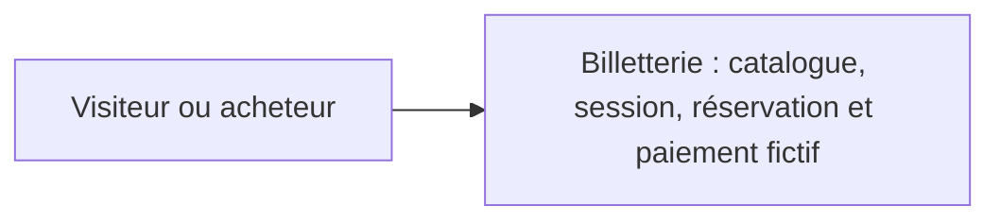
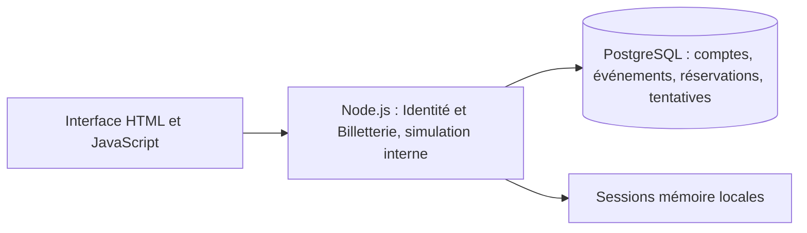
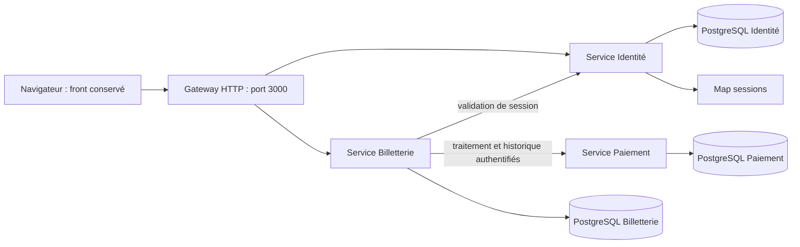
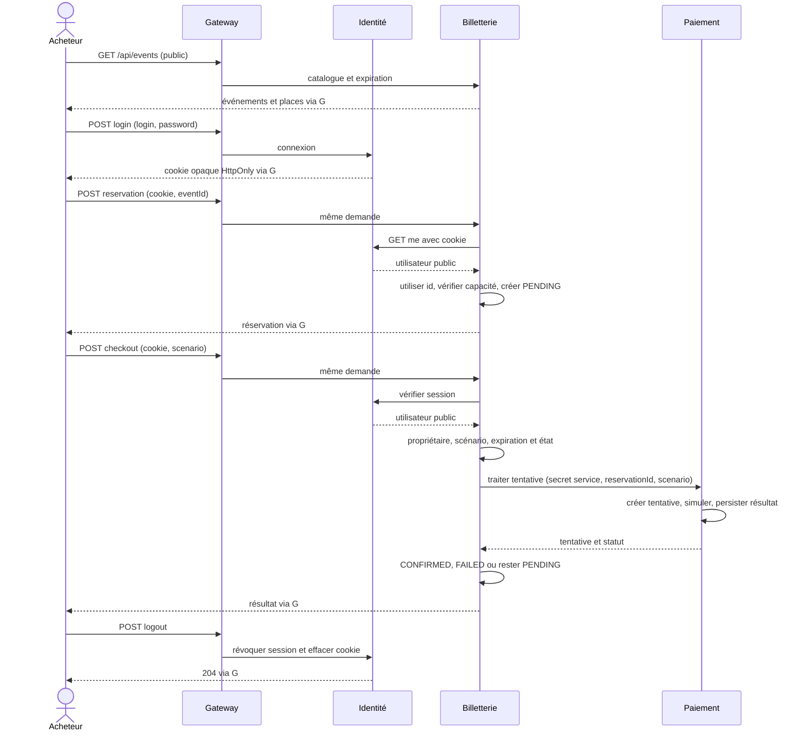
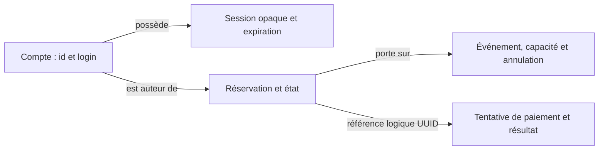

# TP 7 — Extraire trois microservices à partir du découpage métier

Sujet : [Notion TP 7](https://www.notion.so/3efa4f0ae4ab81eab19ad9acb1987fc6), consulté le 30 octobre 2026. Branche `correction/tp7`, depuis `correction/tp6` au commit `b605fc1`.

La cible retient **Identité, Billetterie et Paiement**, avec une gateway technique pour conserver le front et les routes publiques. Les choix et l'alternative à trois services sont justifiés dans [ADR 1](../adr/001-tp7-frontieres-metier.md) et [ADR 2](../adr/002-tp7-stack-donnees-echanges.md).

## C4 contexte existant



## C4 conteneurs existants — TP 6



## C4 conteneurs cibles — TP 7



## Séquence du parcours complet



## Matrice des données et décisions

| Donnée | Propriétaire et écritures autorisées | Lectures nécessaires hors propriétaire |
| --- | --- | --- |
| Compte et hash | Identité : migration/seed, lecture du hash pour login | Aucune lecture de hash ; utilisateur public seulement via HTTP |
| Session opaque | Identité : création, révocation, nettoyage ; Map locale | Billetterie demande une validation HTTP, ne lit pas la Map |
| Événement, capacité et statut | Billetterie : seed et décisions de disponibilité | Navigateur lit le catalogue via gateway |
| Réservation, auteur et expiration | Billetterie : création avec id vérifié, transitions et expiration | Paiement reçoit seulement reservationId, sans accès SQL ni droit de modifier la réservation |
| Tentative et résultat fictif | Paiement : création et transition après simulation | Billetterie consulte l'historique via HTTP après contrôle du propriétaire |

Le découpage garde la décision de réserver la dernière place et l'annulation dans Billetterie. Une évolution du scénario de paiement reste dans Paiement. Les deux services doivent coordonner une évolution qui change simultanément le résultat du paiement et la confirmation d'une réservation : ce coût est assumé et visible.

## Carte des objets et évolution depuis TP 6



La frontière Identité du TP 6 a tenu. Catalogue, disponibilité et réservation restent ensemble : leurs règles nécessitent le même état courant. Paiement est extrait de Billetterie pour lui attribuer le cycle des tentatives et l'exécution fictive ; Billetterie garde la décision de confirmer ou refuser sa réservation. Une relation fonctionnelle entre objets n'impose pas une jointure ou une clé étrangère entre services.

## Contrats HTTP v1 et confiance

Les routes publiques du TP 6 et leurs JSON restent inchangés. Le front appelle uniquement la gateway sur le port 3000. Celle-ci relaie le cookie, les corps JSON, statuts et `Set-Cookie` ; elle ne transmet aucun en-tête d'acteur ou secret de service fourni par le navigateur.

| Échange | Demande | Réponse et responsabilité |
| --- | --- | --- |
| Gateway → Identité : `POST /api/auth/login` | `{login,password}`, éventuel ancien cookie | Utilisateur public et cookie opaque HttpOnly ; créer/révoquer les sessions dans Identité |
| Gateway ou Billetterie → Identité : `GET /api/auth/me` | Cookie `ticketing_session` | `{user:{id,login}}` ou 401 ; Billetterie projette seulement `{id}` dans son contrat `CurrentActor` |
| Gateway → Identité : `POST /api/auth/logout` | Cookie courant | Révocation, cookie effacé et 204 |
| Billetterie → Paiement : `POST /internal/payments` | Secret `x-service-token` et `{reservationId,scenario}` | `{paymentAttempt:{id,reservationId,scenario,status,createdAt}}` |
| Billetterie → Paiement : `GET /internal/reservations/:id/payments` | Secret de service ; UUID de réservation déjà autorisée | `{paymentAttempts:[…]}`, lecture sans mutation |
| Gateway → Billetterie : routes catalogue/réservation/checkout | Même contrat public et cookie qu'au TP 6 | Disponibilité et droits décidés dans Billetterie ; confirmation après résultat Paiement |

Les UUID sont normalisés en minuscules pour l'échange Paiement. Les réponses sont validées au runtime : identifiants, réservation et scénario corrélés à la demande, statuts admis, date ISO UTC. Des champs supplémentaires ne sont pas projetés dans le DTO consommé. Un contrat malformé empêche la confirmation ou le refus de la réservation à partir du résultat Paiement ; la maintenance antérieure peut déjà avoir expiré d'autres réservations.

Les modèles `PaymentAttempt`, `PaymentScenario` et `PaymentStatus` de Billetterie représentent le résultat externe qu'elle consomme derrière ses ports `PaymentProcessor` et `PaymentAttemptReader`. Les modèles et ports de stockage de Paiement appartiennent à son propre module. Les types se ressemblent, mais ne sont pas importés entre services ; le mapping HTTP valide leur contrat à la frontière.

Identité est le seul composant qui reconnaît les tokens. Billetterie le contacte directement et n'accepte aucun identifiant libre du navigateur, même si la gateway est contournée dans un test interne. L'auteur persistant est `user.id`, sans FK sur une base étrangère. Paiement accepte uniquement le secret interservice ; les ports métier et SQL ne sont pas publiés sur l'hôte.

Les refus d'authentification utilisateur d'Identité restent 401. Une erreur d'authentification entre services est une panne technique 503 côté navigateur, afin de ne pas confondre une mauvaise configuration avec une session expirée. Les détails techniques ne sont pas exposés.

Exemple d'achat nominal conservé :

```json
{
  "reservation": {
    "id": "aaaaaaaa-aaaa-4aaa-8aaa-aaaaaaaaaaaa",
    "eventId": "festival-lumieres",
    "customerRef": "user-alice",
    "status": "CONFIRMED",
    "createdAt": "2026-10-30T10:00:00.000Z",
    "expiresAt": "2026-10-30T10:15:00.000Z"
  },
  "paymentAttempt": {
    "id": "bbbbbbbb-bbbb-4bbb-8bbb-bbbbbbbbbbbb",
    "reservationId": "aaaaaaaa-aaaa-4aaa-8aaa-aaaaaaaaaaaa",
    "scenario": "success",
    "status": "SUCCEEDED",
    "createdAt": "2026-10-30T10:00:01.000Z"
  }
}
```

## Stockages et lancement

```sh
docker compose up --build -d --wait
docker compose ps
docker compose logs -f gateway identity ticketing payments
```

Ouvrir [localhost:3000](http://localhost:3000). Les comptes restent `alice / Alice-demo-2027!` et `bob / Bob-demo-2027!`. Les trois services métier, la gateway et les trois PostgreSQL sont visibles séparément dans Compose.

Chaque processus reçoit une seule `DATABASE_URL` et ne rejoint que le réseau de données de son propriétaire. Identité et Billetterie partagent le réseau d'API avec la gateway ; seul Billetterie rejoint aussi le réseau RPC de Paiement. Les réseaux SQL sont internes, distincts, et aucun port PostgreSQL n'est publié. La gateway ne reçoit ni connexion SQL ni secret Paiement. Les identifiants de démonstration et le secret RPC peuvent être remplacés ; le secret RPC doit avoir au moins 32 caractères.

Les migrations sont exécutées avant chaque service, uniquement avec son rôle et sa base. `db/identity` contient les comptes, `db/ticketing` les événements/réservations et `db/payments` les tentatives. L'initialisation est idempotente et ne remplace pas les hashes existants. La référence à une réservation dans Paiement est un UUID logique ; la FK SQL antérieure est retirée de ce stockage privé.

Cette branche initialise trois nouveaux volumes `tp7_identity_data`, `tp7_ticketing_data` et `tp7_payments_data`. Elle ne transfère pas automatiquement les données du volume TP 6 et ne le supprime pas. Les anciennes migrations/seeds restent dans `db/migrations` et `db/seeds` comme fixtures historiques ; elles ne sont plus exécutées par les services TP 7.

## Pannes, délais et redémarrages

| Situation | Réponse observable | Effets et reprise |
| --- | --- | --- |
| Cookie absent ou invalide | 401 sur le privé | Aucun effet sur réservation ou paiement |
| Réservation d'un autre auteur | 403, même avec Paiement coupé | Propriété vérifiée avant historique et maintenance |
| Identité coupée avec cookie à vérifier | 503 sur réservation/achat ; catalogue 200 | Aucun acteur supposé et aucune création de réservation |
| Paiement coupé | Catalogue 200, réservation 201 ; achat/historique 503 | Réservation conservée en attente ; pas de retry automatique |
| Dépendance HTTP trop lente ou contrat invalide | 503 après attente bornée | Une opération distante peut avoir déjà persisté ; résultat incertain à réconcilier |
| Redémarrage de Paiement | Historique persistant, autres processus inchangés | Les sessions et réservations restent valides |
| Redémarrage d'Identité | Anciens cookies 401 ; catalogue public disponible | Comptes et réservations persistent ; nouvelle connexion nécessaire |

Les valeurs par défaut sont `IDENTITY_TIMEOUT_MS=1000`, `PAYMENTS_TIMEOUT_MS=3500`, `GATEWAY_TIMEOUT_MS=10000` et `PAYMENT_SLOW_MS=2000`. Le checkout a un appel Identité et un appel Paiement ; le détail privé conserve l'autorisation puis la relecture du TP 6 et peut consulter deux fois l'historique. Le budget gateway dépasse donc 1 s + 2 × 3,5 s, hors durée des requêtes SQL et travail local. Modifier ces paramètres demande de conserver cette marge. Le signal d'abandon borne aussi la lecture du corps HTTP.

Le délai dépassé n'annule pas une transaction déjà réalisée à distance. Un test HTTP démontre qu'une dépendance lente peut achever sa persistance après l'abandon du client, avec exactement une demande reçue. Le scénario fictif `slow` nominal retourne toujours une tentative et une réservation `PENDING`.

## Tests et preuves

```sh
npm run build
npm run test:unit
npm run test:contracts
npm run check:architecture
docker compose --profile test run --build --rm test
npm run verify:tp7
```

La dernière commande utilise une application démarrée et arrête/redémarre temporairement Paiement et Identité pour éprouver les pannes. Les services sont rétablis même si une assertion échoue. Elle crée quelques réservations de démonstration. Pour cibler un projet Compose précis, utiliser `TP7_PROJECT` et `TP7_COMPOSE_FILE` ; `BASE_URL` permet de changer l'URL publique.

La suite Docker initialise trois bases de test séparées, sans utiliser les volumes de démonstration. Les anciens tests HTTP/authentification/front/migration gardent leurs assertions métier ; les accès aux données de test sont redirigés vers les bases propriétaires et le harness utilise trois vrais serveurs HTTP localhost derrière une vraie gateway. Les faux ports restent réservés aux tests en mémoire et aux contrats qui simulent une dépendance défectueuse.

| Vérification | Résultat |
| --- | --- |
| Référence TP 6 avant extraction | 104/104 tests ordinaires |
| Tests en mémoire | 60/60 : 53 existants et sept pour Paiement |
| Contrats HTTP | 17/17 : secret, cookie, corrélation, UUID majuscules, types/dates, timeout et absence de retry |
| Frontières architecturales | 12/12, aucun import direct entre services ou SQL étranger détecté |
| Isolation et migrations privées | 2/2 : bases/rôles/tables distincts, tables étrangères absentes, hashes préservés |
| Suite complète avec PostgreSQL et réseau | 135/135 tests ordinaires |
| Parcours dans trois processus Docker | Achat confirmé, refus sans session/Bob, auteurs forgés ignorés, déconnexion et ancien cookie rejeté |
| Coupure et reprise Paiement | Catalogue/réservation disponibles, achat/historique 503, Bob 403, historique conservé à la reprise |
| Coupure et reprise Identité | Catalogue disponible, privé 503 avec cookie à vérifier ; anciens cookies 401 au redémarrage, reconnexion possible |
| Image de production | 109 fichiers compilés, aucun test dans le runtime |

La construction et les validations locales utilisent un export exact de l'index Git hors OneDrive, qui évite ses points de réanalyse dans le contexte Docker. Ce sont les mêmes sources, Dockerfile et Compose. La CI GitHub exécute la commande Docker ordinaire.

Le vérificateur étend Clean/CQRS : exactement trois modules, imports interservices refusés, processus limité à son module, gateway sans module métier ni `pg`, propriété des tables et absence de cycles. Il n'est pas une barrière de sécurité exhaustive : le contrôle SQL porte sur les littéraux des tables connues. L'isolation effective des bases repose aussi sur les instances, rôles et réseaux distincts, vérifiés dans les tests et le parcours Compose.

## Contre-expertise et questions ouvertes

La contre-expertise a été menée après la première proposition, puis sur le code. Les observations retenues sont la corrélation réservation/scénario, des budgets couvrant les deux lectures d'historique, la distinction erreur RPC/session utilisateur, et l'acceptation des UUID majuscules. Cette dernière régression a été reproduite en rouge puis corrigée et couverte par contrat et parcours PostgreSQL. Aucun défaut bloquant restant n'a été identifié lors de la revue.

Le découpage ne corrige pas la survente de la dernière place. Le défi séparé reste volontairement en échec pour le TP 8 :

```sh
docker compose --profile test run --rm test sh -c 'npm run migrate:test && npm run test:challenge'
```

Risques conservés pour les TP suivants : achats simultanés, tentatives répétées, absence de clé d'idempotence, résultat Paiement persisté sans transition de réservation après coupure, expiration pendant un appel, réconciliation des états et perte des sessions au redémarrage. Le TP 6 ne comportait déjà pas de transaction englobant paiement et réservation ; trois bases interdisent désormais d'en ajouter une localement. Aucun broker, saga, cache de session partagé ou extraction supplémentaire n'est introduit.

L'absence d'un événement de résultat signifie qu'un paiement accepté mais dont la réponse est perdue peut laisser une réservation `PENDING`. La disponibilité du détail privé dépend aussi de Paiement. Accepter ce coût rend les nouvelles limites observables, sans présenter les microservices comme une amélioration automatique.
