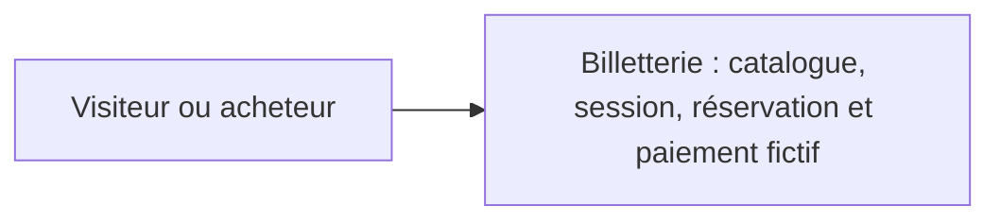
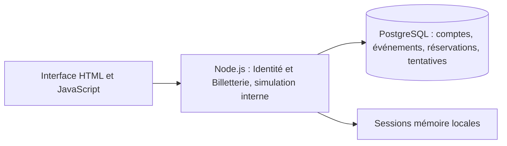
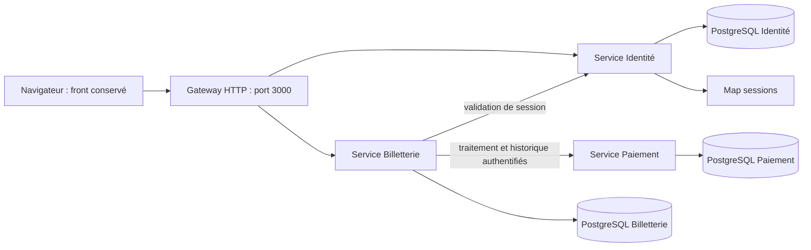
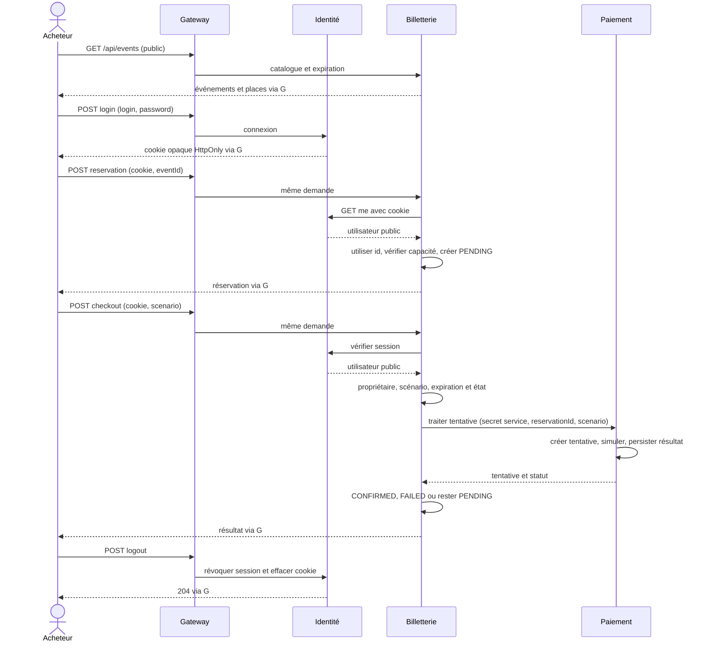

# TP 7 — Extraire trois microservices à partir du découpage métier

Sujet : [Notion TP 7](https://www.notion.so/3efa4f0ae4ab81eab19ad9acb1987fc6), consulté le 30 octobre 2026. Branche `correction/tp7`, depuis `correction/tp6` au commit `b605fc1`.

La cible retient **Identité, Billetterie et Paiement**, avec une gateway technique pour conserver le front et les routes publiques. Les choix et l'alternative à trois services sont justifiés dans [ADR 1](../adr/001-tp7-frontieres-metier.md) et [ADR 2](../adr/002-tp7-stack-donnees-echanges.md).

## C4 contexte existant

## C4 conteneurs existants — TP 6

## C4 conteneurs cibles — TP 7

## Séquence du parcours complet

## Matrice des données et décisions

| Donnée | Propriétaire et écritures autorisées | Lectures nécessaires hors propriétaire |
| --- | --- | --- |
| Compte et hash | Identité : migration/seed, lecture du hash pour login | Aucune lecture de hash ; utilisateur public seulement via HTTP |
| Session opaque | Identité : création, révocation, nettoyage ; Map locale | Billetterie demande une validation HTTP, ne lit pas la Map |
| Événement, capacité et statut | Billetterie : seed et décisions de disponibilité | Navigateur lit le catalogue via gateway |
| Réservation, auteur et expiration | Billetterie : création avec id vérifié, transitions et expiration | Paiement reçoit seulement reservationId, sans accès SQL ni droit de modifier la réservation |
| Tentative et résultat fictif | Paiement : création et transition après simulation | Billetterie consulte l'historique via HTTP après contrôle du propriétaire |

Le découpage garde la décision de réserver la dernière place et l'annulation dans Billetterie. Une évolution du scénario de paiement reste dans Paiement. Les deux services doivent coordonner une évolution qui change simultanément le résultat du paiement et la confirmation d'une réservation : ce coût est assumé et visible.

## Suivi de réalisation

Ce dossier est rédigé avant l'extraction. Les contrats, commandes de lancement et preuves de validation seront complétés à partir du code et des tests exécutés.
